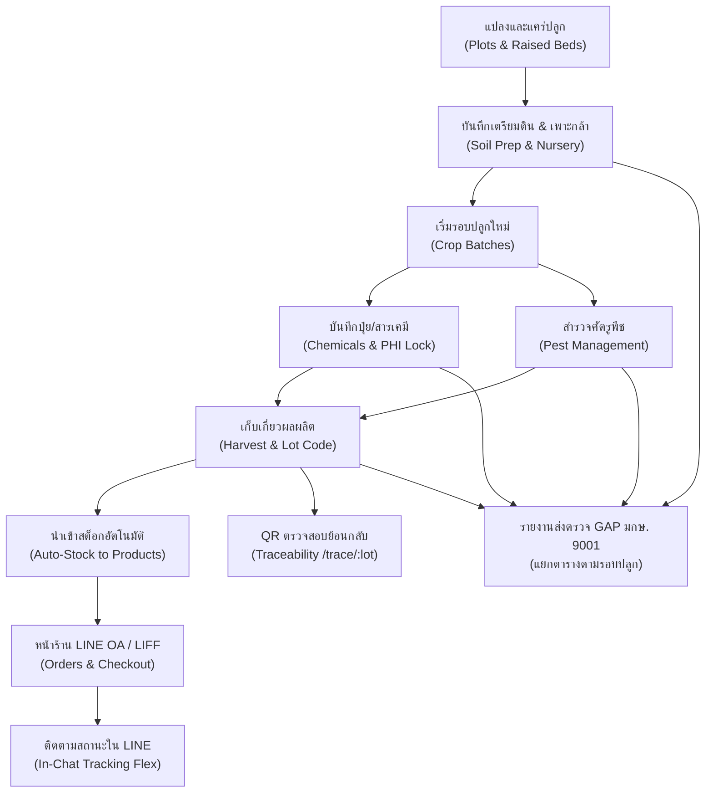
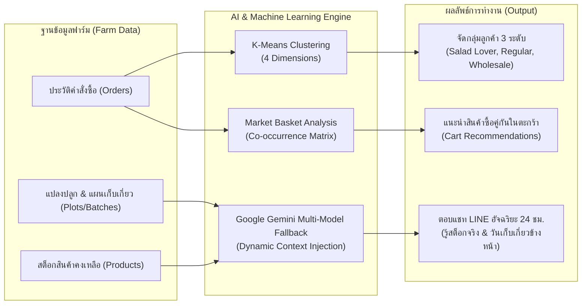
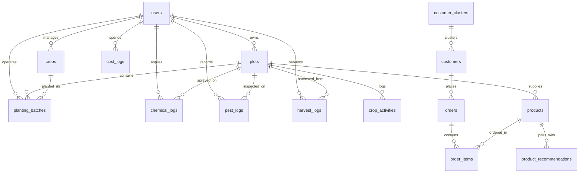

# 🌱 FarmGAP — ระบบบริหารจัดการฟาร์มผักและสั่งซื้อออนไลน์ด้วยปัญญาประดิษฐ์บน LINE Official Account
**(A Vegetable Farm Management and Online Ordering System Using Artificial Intelligence on LINE Official Account)**

FarmGAP เป็นแพลตฟอร์มบริหารจัดการฟาร์มผักตามมาตรฐาน GAP และร้านค้าออนไลน์อัจฉริยะแบบครบวงจร พัฒนาขึ้นสำหรับเจ้าของฟาร์ม/เกษตรกรผู้ปลูกผักสลัดและผักคุณภาพสูง รองรับการบันทึกข้อมูลตามมาตรฐาน **มกษ. 9001** (การจัดการแปลง/แคร่ปลูก, รอบการปลูก, บันทึกเตรียมดิน-เพาะกล้า, การใช้ปุ๋ย/สารชีวภัณฑ์และการคำนวณระยะปลอดภัย PHI, การจัดการศัตรูพืช), การเก็บเกี่ยวและนำเข้าสต็อกสินค้าพร้อมขายทันที (**Harvest-to-Stock**), **การยิงแจ้งเตือน LINE หาลูกค้าเฉพาะกลุ่มด้วย AI (Targeted Push Notification)**, ระบบสั่งซื้อและจัดการออเดอร์แบบ 2 ทิศทางผ่าน **LINE Official Account (In-Chat Ordering, LIFF & Interactive Flex Message)** ตลอดจนระบบ **AI วิเคราะห์จัดกลุ่มลูกค้า (K-Means Clustering)** และ **ผู้ช่วยตอบแชทอัจฉริยะ (Google Gemini LLM)**

---

## 📑 สารบัญ
1. [เทคโนโลยีที่เลือกใช้ (Tech Stack)](#-เทคโนโลยีที่เลือกใช้-tech-stack)
2. [ภาพรวมโมดูลและฟังก์ชันการทำงานล่าสุด (System Modules & Features)](#-ภาพรวมโมดูลและฟังก์ชันการทำงานล่าสุด-system-modules--features)
3. [ระบบ AI และอัลกอริทึมที่ใช้งาน (AI & Analytics Engine)](#-ระบบ-ai-และอัลกอริทึมที่ใช้งาน-ai--analytics-engine)
4. [โครงสร้างฐานข้อมูลโดยละเอียด (Detailed Database Schema)](#-โครงสร้างฐานข้อมูลโดยละเอียด-detailed-database-schema)
5. [โครงสร้างไฟล์และโฟลเดอร์ของโปรเจกต์ (Project Structure & File Directory)](#-โครงสร้างไฟล์และโฟลเดอร์ของโปรเจกต์-project-structure--file-directory)
6. [โครงสร้างผู้ใช้งานระบบและ Use Case ทั้ง 13 ข้อ (Actors & Use Cases)](#-โครงสร้างผู้ใช้งานระบบและ-use-case-ทั้ง-13-ข้อ-actors--use-cases)
7. [การตั้งค่าบน LINE Developers Console & LINE Official Account](#-การตั้งค่าบน-line-developers-console--line-official-account)
8. [คู่มือการติดตั้งและการรันระบบ (Installation & Setup Guide)](#-คู่มือการติดตั้งและการรันระบบ-installation--setup-guide)
9. [มาตรฐานความปลอดภัยและการรับรอง GAP (GAP Compliance Criteria)](#-มาตรฐานความปลอดภัยและการรับรอง-gap-gap-compliance-criteria)

---

## 💻 เทคโนโลยีที่เลือกใช้ (Tech Stack)

### 🎨 ฝั่ง Frontend (Web Application & LIFF)
| เทคโนโลยี | หน้าที่และการทำงานในระบบ |
| :--- | :--- |
| **React 19** | แกนหลักในการพัฒนา Single Page Application (SPA) จัดการ State และ Component-based UI |
| **Vite** | Build Tool ประสิทธิภาพสูง รองรับ Hot Module Replacement (HMR) และ Bundle Optimization |
| **TailwindCSS (v4)** | Utility-first CSS Framework สำหรับสร้าง Responsive Design, Glassmorphism และธีมการเกษตรทันสมัย |
| **Recharts** | ไลบรารีเรนเดอร์กราฟสถิติผลผลิต ยอดขาย และแนวโน้มรายได้ (Bar Chart / Area Chart) |
| **Lucide React** | ชุดไอคอน UI คุณภาพสูง คมชัด สื่อความหมายในทุกเมนู |
| **@line/liff** | LINE Front-end Framework SDK ดึงข้อมูลผู้ใช้ (`userId`, `displayName`, `pictureUrl`) อัตโนมัติเมื่อเปิดผ่านแอป LINE |
| **Axios** | จัดการ HTTP Requests เชื่อมต่อ Backend REST API พร้อม Auto-inject JWT Bearer Token |
| **date-fns** | จัดการและคำนวณรูปแบบวันที่ (เช่น คำนวณวันเก็บเกี่ยวปลอดภัย PHI, วันเก็บเกี่ยวผลผลิต) |
| **Sonner** | ไลบรารีแสดง Toast Notification แจ้งเตือนสถานะการบันทึก การลบ และการแจ้งเตือนต่างๆ |

### ⚙️ ฝั่ง Backend (RESTful API, Webhook & Services)
| เทคโนโลยี | หน้าที่และการทำงานในระบบ |
| :--- | :--- |
| **Node.js & Express.js** | รัน Server ให้บริการ RESTful API และ LINE Messaging API Webhook |
| **MySQL2 (Connection Pool)** | เชื่อมต่อฐานข้อมูล MySQL รองรับ Connection Pooling, Prepared Statements และ Transactions |
| **JSON Web Token (JWT)** | ยืนยันตัวตนและกำหนดสิทธิ์ผู้ใช้งาน (Authentication & Authorization) |
| **@line/bot-sdk** | SDK สำหรับส่งข้อความโต้ตอบอัตโนมัติ (Reply Token) และแจ้งเตือนสถานะจัดส่ง (Push Message) ผ่าน Flex Message |
| **Crypto (Node.js Built-in)** | คำนวณ HMAC-SHA256 ตรวจสอบความถูกต้องของ LINE Webhook Signature |
| **Google Gemini API** | ปัญญาประดิษฐ์ LLM ให้บริการผู้ช่วยแชทบอทตอบคำถามสต็อกและวันเก็บเกี่ยวผักใน LINE ตลอด 24 ชม. |
| **Multer** | จัดการอัปโหลดไฟล์ภาพถ่าย (สลิปโอนเงิน, ภาพถ่ายแปลงปลูก, ภาพผลผลิต) |

---

## 🌟 ภาพรวมโมดูลและฟังก์ชันการทำงานล่าสุด (System Modules & Features)



### 1. 🌿 ระบบแปลงปลูกและรอบการปลูก (Plots & Crop Batches)
- **การ์ดแปลงและแคร่ปลูก:** แสดงสถานะแปลงแบบเรียลไทม์ (แปลงว่าง `empty`, เพาะกล้า `nursery`, กำลังปลูก `growing`, พร้อมเก็บเกี่ยว `harvest_ready`)
- **การเริ่มรอบปลูก (Batch Code Generation):** สร้างรหัสรอบการปลูกอัตโนมัติในรูปแบบ `BATCH-YYYYMM-XX/แคร่ที่Y-RZ` เพื่อใช้อ้างอิงตลอดอายุผลผลิต
- **บันทึกแยกรายรอบปลูก:** ข้อมูลของแต่ละรอบปลูกจะถูกผูกกับ `batch_id` ทำให้ประวัติการปลูกของรอบใหม่ไม่ปะปนกับรอบเก่า แม้จะปลูกในแปลงหรือแคร่เดิม

### 2. 🪴 ระบบบันทึกการเตรียมดิน และการเพาะกล้า (Soil Prep & Nursery Log)
- **บันทึกการเตรียมดิน (Soil Preparation):** บันทึกสูตรผสมดิน วันที่เตรียมดิน และสภาพความพร้อมของแปลงก่อนเริ่มลงปลูกจริง
- **บันทึกการเพาะเมล็ด / เพาะกล้า (Seed Nursery):** บันทึกวันที่เริ่มเพาะ ชนิดเมล็ดพันธุ์ สารปรับปรุงสภาพ และตัดช่องข้อมูลส่วนเกินที่ไม่จำเป็นออก เพื่อความคล่องตัวในการปฏิบัติงานจริง
- **Crop Lifecycle Timeline:** แสดงไทม์ไลน์พัฒนาการของพืชในแปลง ตั้งแต่วันเตรียมดิน วันเพาะกล้า วันย้ายแปลงปลูก จนถึงประมาณการวันเก็บเกี่ยว

### 3. 🧪 ระบบบันทึกปุ๋ย สารเคมี และควบคุมระยะปลอดภัย (Chemicals & PHI Lock)
- **ระบบจำแนกสถานะแปลงอัจฉริยะ (4 สถานะ):** แยกกลุ่มตัวเลือกแปลงในฟอร์มเป็น `🌱 แปลงที่กำลังปลูก`, `🌱 แปลงที่กำลังเพาะกล้า`, `✨ แปลงที่พร้อมเก็บเกี่ยวแล้ว (100%)` (พร้อมป้ายเตือนความเสี่ยงติดค่า PHI) และล็อกไม่ให้เลือก `⚪ แปลงว่าง`
- **คำนวณระยะปลอดภัยก่อนเก็บเกี่ยว (Pre-Harvest Interval - PHI):** คำนวณวันปลอดภัยอัตโนมัติจาก วันที่พ่นสาร + จำนวนวัน PHI
- **ระบบล็อกการตัดเก็บเกี่ยว (Harvest Lock):** ป้องกันไม่ให้เก็บเกี่ยวผักหากยังไม่พ้นกำหนดวันปลอดภัย PHI ทั้งระดับหน้าจอและระดับ API เพื่อการันตีความปลอดภัยไร้สารตกค้าง 100%
- **บันทึกอุปกรณ์ป้องกันตนเอง (Safety PPE):** บันทึกการสวมใส่อุปกรณ์คุ้มครองความปลอดภัยส่วนบุคคลของผู้ปฏิบัติงานตามเกณฑ์ มกษ. 9001

### 4. 🐛 ระบบบันทึกการสำรวจและจัดการศัตรูพืช (Pest & Disease Control)
- บันทึกการตรวจพบโรคและแมลงศัตรูพืช ระดับความรุนแรง และความเสียหาย
- บันทึกมาตรการควบคุมและบำบัดรักษา โดยมุ่งเน้นการใช้วิธีกลและสารชีวภัณฑ์ (Biological Control) เพื่อลดการใช้สารเคมี

### 5. 🧺 ระบบเก็บเกี่ยวผลผลิต นำเข้าสต็อกอัตโนมัติ และยิงแจ้งเตือนเฉพาะกลุ่ม (Harvest-to-Stock & Targeted Push)
- **1-Click Harvest to Inventory:** เมื่อบันทึกการเก็บเกี่ยวผลผลิต เจ้าของฟาร์มสามารถเลือก "นำเข้าสต็อกสินค้าทันที" โดยระบุจำนวนและราคาต่อหน่วย
- **Auto Sync Products:** ระบบจะปรับยอดสต็อกในตาราง `products` ให้อัตโนมัติทันที พร้อมเปิดขายบนหน้าร้าน LINE
- **AI Smart Marketing Broadcast (Targeted Push):** หลังเก็บเกี่ยวผลผลิต เจ้าของฟาร์มสามารถกดยิงแจ้งเตือน LINE Flex Message หาลูกค้าเฉพาะกลุ่มได้ทันที (เลือกส่งหา **🎯 คนที่ชอบ/เคยสั่งผักชนิดนี้โดยเฉพาะ**, ส่งตาม **👥 กลุ่มลูกค้า K-Means Cluster**, หรือส่งหาทุกคน)
- **Traceability Lot Generation:** ระบบออกรหัสรุ่นผลผลิต (Lot Number) ประจำรอบการเก็บเกี่ยวเพื่อใช้สำหรับ QR Code ตรวจสอบย้อนกลับ

### 6. 🛒 ระบบพาณิชย์อิเล็กทรอนิกส์และแชทบอท LINE OA แบบ 2 ทิศทาง (LINE E-Commerce & Chatbot)
- **สั่งซื้อผ่าน LINE LIFF:** ลูกค้าเลือกดูรายการผักสด ใส่ตะกร้า พร้อมระบบ AI แนะนำสินค้าซื้อคู่กัน (Market Basket) และแนบสลิปโอนเงิน
- **สั่งซื้อผ่านข้อความแชท (In-Chat Ordering):** ลูกค้าพิมพ์สั่งผัก เช่น *"สั่งกรีนโอ๊ค 2 ถุง"* ระบบถอดรหัสคำสั่งซื้อ สกัดที่อยู่จัดส่ง สรุปยอดเงิน และส่งการ์ดชำระเงินพร้อมเพย์ให้ทันที
- **เจ้าของฟาร์มจัดการออเดอร์ในแชท LINE ได้ทันที (2-Way Interactive Admin Flex):** เมื่อมีออเดอร์หรือสลิปใหม่ ระบบแจ้งเตือนเข้า LINE เจ้าของฟาร์มพร้อมปุ่มกดโต้ตอบ (Postback) กดอนุมัติสลิป อัปเดตสถานะจัดส่ง หรือยกเลิกออเดอร์ได้จากในแชททันที
- **ติดตามสถานะการจัดส่งในไลน์ (In-Chat Tracking):** ลูกค้ากดปุ่ม "ตรวจสอบสถานะการจัดส่ง" ในการ์ดสินค้า และตรวจเช็คสถานะได้โดยตรงในแชท LINE ผ่าน Flex Message โดยไม่ต้องเปิดหน้าเว็บภายนอก
- **การ์ดจัดส่งสำเร็จ & การ์ดยกเลิกออเดอร์:** แสดงปุ่ม **"🛒 กดสั่งซื้อผักใหม่"** (พิมพ์ *เมนูผัก* อัตโนมัติ) และปุ่ม "ดูประวัติการสั่งซื้อ" ที่ทำงานได้อย่างราบรื่นในห้องแชท

### 7. 🔍 ระบบตรวจสอบย้อนกลับผลผลิต (Traceability via QR Code)
- ผู้บริโภคสามารถสแกน QR Code บนถุงผักเพื่อเข้าสู่หน้า `/trace/:lot`
- แสดงข้อมูลโปร่งใส: ชนิดผัก, แปลงและแคร่ปลูก, วันที่เตรียมดิน, วันที่ปลูก, วันที่ตัดเก็บเกี่ยว, สารชีวภาพที่ใช้ และใบรับรอง GAP

### 8. 📄 ระบบออกรายงานแบบบันทึกส่งตรวจ GAP (มกษ. 9001)
- ออกแบบฟอร์แมตเอกสารขนาด A4 สวยงาม พร้อมสั่งพิมพ์หรือบันทึกเป็น PDF เพื่อยื่นต่อผู้ตรวจประเมิน GAP
- **แยกตารางตามรอบการปลูกอย่างชัดเจน:** แต่ละรอบการปลูกจะแสดงข้อมูลเตรียมดิน ข้อมูลการดูแลรักษา และการเก็บเกี่ยวในตารางของตัวเอง ไม่นำข้อมูลรอบเก่ามาปะปนในตารางเดียวกัน

> 💡 **หมายเหตุเกี่ยวกับการปรับปรุงระบบน้ำ:** ในระบบเวอร์ชันปัจจุบัน ได้ทำการปลดระวางหน้า `/water` และตารางบันทึกการรดน้ำออกจากระบบเรียบร้อยแล้ว เพื่อให้ขั้นตอนการบันทึกข้อมูลของฟาร์มมีความกระชับ รวดเร็ว และตรงกับการปฏิบัติงานจริงในแปลงมากที่สุด

---

## 🧠 ระบบ AI และอัลกอริทึมที่ใช้งาน (AI & Analytics Engine)



### 1. 🤖 Google Gemini LLM Multi-Model Fallback (อัปเดตล่าสุด)
ระบบแชทบอทใช้โมเดลภาษาขนาดใหญ่ของ Google ในการตอบคำถามลูกค้าเกี่ยวกับฟาร์ม ความปลอดภัย GAP และสถานะสต็อก โดยจัดลำดับโมเดลและมีระบบ Fallback อัตโนมัติ:

```javascript
// ลำดับโมเดลที่ตั้งค่าไว้ใน backend/src/services/line/ai/gemini.js
const candidateModels = [
  process.env.GEMINI_MODEL,
  'gemini-3.5-flash-lite', // ตัวหลัก: ฟรีวันละ 500 ครั้ง เร็ว ฉลาดพอดีกับงานร้านค้า/ฟาร์ม
  'gemini-3.1-flash-lite', // สำรอง 1: ฟรีอีก 500 ครั้ง/วัน (รวมเป็น 1,000 ครั้ง/วัน)
  'gemini-3.6-flash',      // สำรอง 2: ตัวท็อป (กรณี Lite ใช้งานไม่ได้)
  'gemini-2.5-flash-lite', // สำรอง 3
].filter(Boolean);
```

- **Quota-Maximized Strategy:** เลือกใช้ `gemini-3.5-flash-lite` เป็นหลัก รองรับโควต้าฟรีได้ถึง **500 ครั้ง/วัน (15 RPM)** ทำให้บอทสามารถตอบแชทลูกค้าได้ทั้งวันโดยไม่ติดขัด
- **Smart 429 Fallback Handling:** เมื่อโมเดลตัวใดตัวหนึ่งพบปัญหา Quota เต็มหรือ Rate Limit (HTTP 429) ระบบจะสลับไปเรียกโมเดลสำรองตัวถัดไปในลิสต์ให้อัตโนมัติทันที
- **Dynamic Farm Context:** ก่อนที่ AI จะตอบคำถาม ระบบจะดึงข้อมูลสต็อกผักที่พร้อมขายและรอบแปลงที่กำลังปลูกอยู่มาใส่ใน System Instruction แบบเรียลไทม์ ทำให้ AI สามารถตอบคำถามได้ เช่น:
  > *"ผักบุ้งตอนนี้หมดสต็อกชั่วคราวครับ แต่ทางฟาร์มกำลังปลูกอยู่ที่แปลง 2 และคาดว่าจะพร้อมเก็บเกี่ยวในวันที่ 25 ตุลาคมนี้ครับ"*

### 2. 🎯 K-Means Customer Clustering
วิเคราะห์พฤติกรรมการซื้อเพื่อจัดกลุ่มลูกค้าอัตโนมัติ ช่วยให้เจ้าของฟาร์มส่งโปรโมชันได้ตรงกลุ่ม:
- **ฟีเจอร์เวกเตอร์ 4 มิติ:** `order_count` (จำนวนบิล), `total_spend` (ยอดซื้อรวม), `avg_order_value` (ยอดเฉลี่ยต่อบิล), `total_items` (จำนวนผักรวม)
- **การแบ่งกลุ่ม ($K=3$):**
  1. *กลุ่มสลัดเลิฟเวอร์ (Salad Lovers)* — สั่งบ่อย เน้นผักสลัด ยอดปานกลาง
  2. *กลุ่มลูกค้าประจำ (Regular Buyers)* — ซื้อสม่ำเสมอ ผักหลากหลาย
  3. *กลุ่มลูกค้าขายส่ง/องค์กร (Bulk Buyers)* — ยอดซื้อสูง สั่งครั้งละมากๆ

ฟีเจอร์เวกเตอร์ทั้ง 4 มิติคือชุดตัวเลขที่สรุปพฤติกรรมการซื้อของลูกค้าแต่ละคน เพื่อให้อัลกอริทึม K-Means นำไปเปรียบเทียบและจัดกลุ่มลูกค้าที่มีลักษณะใกล้เคียงกัน โดยแต่ละตัวแปรมีความหมายดังนี้

- **`order_count` (จำนวนบิล):** จำนวนครั้งที่ลูกค้าสั่งซื้อในช่วงเวลาที่เก็บข้อมูล ใช้สะท้อนความถี่และความสม่ำเสมอในการซื้อ เช่น ลูกค้าที่สั่งทุกสัปดาห์จะมีค่าสูงกว่าลูกค้าที่สั่งเพียงครั้งเดียว
- **`total_spend` (ยอดซื้อรวม):** ยอดเงินจากทุกบิลของลูกค้าในช่วงเวลาที่พิจารณา ช่วยเปรียบเทียบว่าลูกค้ารายใดสร้างรายได้ให้ฟาร์มมากกว่า ทั้งนี้เป็นยอดรวมในช่วงข้อมูลที่เก็บ ไม่ใช่มูลค่าตลอดอายุลูกค้าโดยอัตโนมัติ
- **`avg_order_value` หรือ AOV (ยอดเฉลี่ยต่อบิล):** คำนวณจาก `total_spend ÷ order_count` เพื่อดูว่าโดยเฉลี่ยลูกค้าจ่ายเงินเท่าไรต่อการสั่งซื้อหนึ่งครั้ง เช่น 150 บาทต่อบิล เทียบกับ 3,000 บาทต่อบิล
- **`total_items` (จำนวนผักรวม):** ปริมาณสินค้ารวมที่ลูกค้าสั่ง เช่น จำนวนชิ้นหรือจำนวนถุง ใช้ช่วยแยกว่าลูกค้ามียอดซื้อสูงเพราะซื้อสินค้าราคาสูง หรือเพราะสั่งสินค้าในปริมาณมาก โดยหน่วยที่ใช้ขึ้นอยู่กับวิธีบันทึกข้อมูลของระบบ

### ทำไมต้องใช้ทั้ง 4 มิติ?

หากพิจารณาเฉพาะ `total_spend` ลูกค้าสองรายที่มียอดซื้อรวมเท่ากันอาจดูเหมือนกัน ทั้งที่มีรูปแบบการซื้อแตกต่างกัน เมื่อนำตัวชี้วัดทั้ง 4 มิติมาพิจารณาร่วมกัน จะเห็นความแตกต่างได้ชัดขึ้น เช่น

| ตัวชี้วัด | ลูกค้า A: ซื้อบ่อย | ลูกค้า B: ซื้อครั้งละมาก |
| --- | --- | --- |
| `order_count` | 20 ครั้ง | 1 ครั้ง |
| `total_spend` | 10,000 บาท | 10,000 บาท |
| `avg_order_value` | 500 บาท/บิล | 10,000 บาท/บิล |
| `total_items` | 60 ถุง (เฉลี่ย 3 ถุง/บิล) | 200 ถุง |

จากตัวอย่าง ลูกค้า A มีรูปแบบการซื้อถี่และยอดต่อบิลไม่สูง ส่วนลูกค้า B สั่งเพียงครั้งเดียวแต่ซื้อในปริมาณมาก จึงอาจเหมาะกับข้อเสนอหรือบริการสำหรับการสั่งซื้อจำนวนมาก อย่างไรก็ตาม ตัวชี้วัดทั้ง 4 มิตินี้บอกความถี่ มูลค่า และปริมาณการซื้อ แต่ไม่ได้ระบุชนิดผักหรือความชอบด้านอาหารโดยตรง

### 3. 🥦 Market Basket Analysis (ระบบแนะนำผักซื้อคู่กัน)
วิเคราะห์ความถี่ในการสั่งซื้อร่วมกัน (Co-occurrence) ในตาราง `order_items` เพื่อแนะนำผักที่ลูกค้าคนอื่นมักจะซื้อคู่กันขึ้นมาในหน้าตะกร้าสินค้า

---

## 🗄️ โครงสร้างฐานข้อมูลโดยละเอียด (Detailed Database Schema)

ฐานข้อมูลระบบ FarmGAP ประกอบด้วยตารางทั้งหมด **18 ตาราง** ที่เชื่อมโยงกันอย่างเป็นระบบ:



### รายละเอียดโครงสร้างตารางทั้ง 18 ตาราง:

#### 1. ตาราง `users` (ข้อมูลผู้ใช้งานระบบ)
| คอลัมน์ | ประเภทข้อมูล | รายละเอียด |
| :--- | :--- | :--- |
| `id` | INT (PK, AI) | รหัสผู้ใช้งาน |
| `email` | VARCHAR(255) UNIQUE | อีเมลสำหรับเข้าสู่ระบบ |
| `password_hash` | VARCHAR(255) | รหัสผ่านที่เข้ารหัสด้วย bcrypt |
| `display_name` | VARCHAR(255) | ชื่อที่ใช้แสดงในระบบ |
| `username` | VARCHAR(100) UNIQUE | ชื่อผู้ใช้งานสำหรับเข้าสู่ระบบ |
| `farm_name` | VARCHAR(255) | ชื่อฟาร์ม |
| `phone` | VARCHAR(50) | เบอร์โทรศัพท์ติดต่อฟาร์ม |
| `role` | VARCHAR(50) | บทบาทผู้ใช้งานระบบหลังบ้าน (`owner` = เจ้าของฟาร์ม / เกษตรกร) |
| `bank_name` / `bank_account_no` | VARCHAR | ชื่อธนาคารและเลขบัญชีรับโอนเงิน |
| `promptpay_number` | VARCHAR(50) | หมายเลขพร้อมเพย์สำหรับสร้าง QR Code รับชำระเงิน |
| `line_user_id` | VARCHAR(255) | LINE User ID ของเจ้าของฟาร์มสำหรับรับแจ้งเตือนออเดอร์ |
| `created_at` | TIMESTAMP | วันเวลาที่สร้างบัญชี |

#### 2. ตาราง `crops` (คลังข้อมูลชนิดผักและเกณฑ์การเติบโต)
| คอลัมน์ | ประเภทข้อมูล | รายละเอียด |
| :--- | :--- | :--- |
| `id` | INT (PK, AI) | รหัสชนิดผัก |
| `user_id` | INT (FK) | ผู้สร้างข้อมูลพืช |
| `name` | VARCHAR(100) | ชื่อพืช/ผัก (เช่น กรีนโอ๊ค, เรดโอ๊ค, คอส) |
| `scientific_name` | VARCHAR(150) | ชื่อวิทยาศาสตร์ |
| `category` | VARCHAR(50) | หมวดหมู่พืช (ค่าเริ่มต้น: ผักสลัด / ผักใบ) |
| `growth_days` | INT | ระยะเวลาปลูกจนถึงเก็บเกี่ยว (วัน) |
| `nursery_days` | INT | ระยะเวลาในการเพาะกล้า (วัน) |
| `harvest_unit` | VARCHAR(50) | หน่วยนับผลผลิต (เช่น กก., ต้น, ถุง) |
| `default_bag_size` | VARCHAR(100) | ขนาดบรรจุภัณฑ์มาตรฐาน |
| `default_price` | DECIMAL(10,2) | ราคาขายตั้งต้นต่อหน่วย |
| `icon` | VARCHAR(50) | ไอคอนแสดงผล |
| `notes` | TEXT | บันทึกเพิ่มเติม |

#### 3. ตาราง `plots` (ข้อมูลแปลงปลูกและแคร่)
| คอลัมน์ | ประเภทข้อมูล | รายละเอียด |
| :--- | :--- | :--- |
| `id` | INT (PK, AI) | รหัสแปลง |
| `user_id` | INT (FK) | ผู้รับผิดชอบแปลง |
| `plot_number` | INT | ลำดับแปลง/หมายเลขแปลง |
| `name` | VARCHAR(255) | ชื่อแปลง/แคร่ปลูก |
| `dimension` | VARCHAR(100) | ขนาดแคร่ (เช่น แคร่ 2 x 6 เมตร) |
| `soil_recipe` | TEXT | สูตรผสมดินปลูกของแปลง |
| `soil_prep_date` | DATE | วันที่เตรียมดินเสร็จสิ้น |
| `seed_prep_date` | DATE | วันที่เริ่มเพาะเมล็ด |
| `seed_crop_id` | INT | ชนิดพืชที่กำลังเพาะกล้า |
| `crop_name` | VARCHAR(255) | ชื่อพืชที่ปลูกอยู่ในปัจจุบัน |
| `area_sqm` | DECIMAL(10,2) | พื้นที่แปลง (ตารางเมตร) |
| `planting_date` | DATE | วันที่ย้ายกล้าลงแปลงปลูก |
| `expected_harvest_date` | DATE | วันที่คาดว่าจะเก็บเกี่ยวผลผลิต |
| `status` | VARCHAR(50) | สถานะแปลง (`empty`, `nursery`, `growing`, `harvest_ready`) |
| `current_batch_id` | INT | รหัสรอบปลูกปัจจุบันที่กำลังทำงาน |
| `field_safety_status` | VARCHAR(50) | สถานะความปลอดภัยแปลง (เช่น ปลอดภัย) |

#### 4. ตาราง `planting_batches` (รอบการปลูกพืช)
| คอลัมน์ | ประเภทข้อมูล | รายละเอียด |
| :--- | :--- | :--- |
| `id` | INT (PK, AI) | รหัสรอบการปลูก |
| `user_id` | INT (FK) | เจ้าของรอบปลูก |
| `batch_code` | VARCHAR(50) | รหัสรอบปลูกเฉพาะ (เช่น `BATCH-202610-01/แคร่ที่1-R1`) |
| `plot_id` | INT (FK) | แปลงที่ใช้ปลูก |
| `crop_id` | INT (FK) | ชนิดพืชที่ปลูก |
| `start_date` | DATE | วันที่เริ่มต้นรอบการปลูก |
| `expected_harvest_date` | DATE | วันที่คาดว่าจะเก็บเกี่ยว |
| `actual_harvest_date` | DATE | วันที่ตัดเก็บเกี่ยวจริง |
| `total_damaged_count` | INT | จำนวนต้นที่เสียหายระหว่างรอบ |
| `total_harvested_count` | INT | จำนวนต้นที่ตัดเก็บเกี่ยวได้สำเร็จ |
| `status` | VARCHAR(50) | สถานะรอบปลูก (`growing`, `completed`, `cancelled`) |
| `seed_prep_date` | DATE | วันที่เริ่มเพาะเมล็ดสำหรับรอบนี้ (สำหรับคำนวณวันเก็บเกี่ยวร่วม) |
| `soil_recipe` | TEXT | สูตรดินที่ใช้เฉพาะรอบนี้ |
| `soil_prep_date` | DATE | วันที่เตรียมดินเสร็จสิ้นสำหรับรอบนี้ |
| `notes` | TEXT | บันทึกรอบการปลูก |

#### 5. ตาราง `crop_activities` (บันทึกกิจกรรมและพัฒนาการในแปลง)
| คอลัมน์ | ประเภทข้อมูล | รายละเอียด |
| :--- | :--- | :--- |
| `id` | INT (PK, AI) | รหัสบันทึกกิจกรรม |
| `user_id` | INT (FK) | ผู้บันทึก |
| `plot_id` | INT (FK) | แปลงที่ปฏิบัติงาน |
| `batch_id` | INT (FK) | รหัสรอบการปลูกที่กิจกรรมนี้สังกัด (ช่วยแยกกิจกรรมตามรอบปลูก) |
| `activity_date` | DATE | วันที่ปฏิบัติงาน |
| `stage` | VARCHAR(50) | ขั้นตอน (`soil_prep`, `seed_nursery`/`seeding`, `planting`, `maintenance`, `fertilizing`, `harvest`) |
| `title` | VARCHAR(255) | หัวข้อกิจกรรม (เช่น บันทึกเตรียมดิน, ย้ายกล้าลงแคร่) |
| `materials_used` | TEXT | วัสดุ/สารที่ใช้ |
| `details` | TEXT | รายละเอียดการปฏิบัติงาน |
| `operator_name` | VARCHAR(255) | ชื่อผู้ปฏิบัติงาน |
| `source_type` / `source_id` | VARCHAR / INT | แหล่งที่มาของกิจกรรมกรณีซิงก์จากโมดูลอื่น |

#### 6. ตาราง `chemical_logs` (บันทึกการใช้ปุ๋ย สารปรับปรุง และสารเคมี)
| คอลัมน์ | ประเภทข้อมูล | รายละเอียด |
| :--- | :--- | :--- |
| `id` | INT (PK, AI) | รหัสการบันทึก |
| `user_id` | INT (FK) | ผู้บันทึก |
| `plot_id` | INT (FK) | แปลงที่ใส่ปุ๋ย/พ่นสาร |
| `log_date` | DATE | วันที่ปฏิบัติงาน |
| `chem_type` | VARCHAR(100) | ประเภทสาร (ปุ๋ยอินทรีย์, ชีวภัณฑ์, ปุ๋ยเคมี) |
| `product_name` | VARCHAR(255) | ชื่อทางการค้า/ชื่อสามัญ |
| `amount` | DECIMAL(10,2) | ปริมาณที่ใช้ |
| `unit` | VARCHAR(50) | หน่วยวัด (เช่น กรัม, ลิตร, ซีซี) |
| `reason` | TEXT | สาเหตุหรือวัตถุประสงค์ในการใส่ |
| `safety_ppe` | BOOLEAN | บันทึกการสวมใส่อุปกรณ์ป้องกัน (PPE) |
| `phi_days` | INT | ระยะเวลาปลอดภัยก่อนเก็บเกี่ยว (วัน) |
| `worker_name` | VARCHAR(255) | ผู้ปฏิบัติงาน |

#### 7. ตาราง `pest_logs` (บันทึกการสำรวจและจัดการโรคแมลง)
| คอลัมน์ | ประเภทข้อมูล | รายละเอียด |
| :--- | :--- | :--- |
| `id` | INT (PK, AI) | รหัสบันทึก |
| `user_id` | INT (FK) | ผู้บันทึก |
| `plot_id` | INT (FK) | แปลงที่ตรวจพบ |
| `batch_id` | INT (FK) | รอบปลูกที่พบ |
| `log_date` | DATE | วันที่สำรวจ |
| `pest_or_disease` | VARCHAR(255) | ชนิดศัตรูพืชหรือโรคที่พบ |
| `severity` | VARCHAR(50) | ระดับความรุนแรง (น้อย, ปานกลาง, มาก) |
| `damaged_count` | INT | จำนวนต้นที่เสียหาย |
| `treatment_method` | TEXT | วิธีการบำบัดรักษา/กำจัด |
| `worker_name` | VARCHAR(255) | ผู้สำรวจ |

#### 8. ตาราง `harvest_logs` (บันทึกการเก็บเกี่ยวผลผลิต)
| คอลัมน์ | ประเภทข้อมูล | รายละเอียด |
| :--- | :--- | :--- |
| `id` | INT (PK, AI) | รหัสการตัดเก็บเกี่ยว |
| `user_id` | INT (FK) | ผู้บันทึก |
| `plot_id` | INT (FK) | แปลงที่ตัดผลผลิต |
| `batch_id` | INT (FK) | รหัสรอบการปลูก |
| `harvest_date` | DATE | วันที่ตัดเก็บเกี่ยว |
| `quantity` | DECIMAL(10,2) | ปริมาณที่เก็บเกี่ยวได้ |
| `unit` | VARCHAR(50) | หน่วยวัด (เช่น กก.) |
| `lot_code` | VARCHAR(100) | รหัสรุ่นผลผลิต (Lot Code สำหรับ Traceability) |
| `destination` | VARCHAR(50) | แหล่งจัดเก็บ (เช่น ห้องเย็น, นำส่งหน้าร้าน) |
| `stocked_quantity` | INT | ปริมาณที่นำเข้าสต็อกสินค้าพร้อมขาย |
| `stock_status` | VARCHAR(50) | สถานะการนำเข้าสต็อก (`unstocked`, `stocked`) |
| `product_id` | INT (FK) | สินค้าที่ผูกเข้าสต็อก |
| `quality_grade` | VARCHAR(50) | เกรดคุณภาพผลผลิต (เช่น เกรด A, เกรดส่งออก) |
| `harvest_hygiene` | VARCHAR(50) | สุขอนามัยในการเก็บเกี่ยวตามเกณฑ์ GAP |

#### 9. ตาราง `products` (สินค้าและสต็อกพร้อมขาย)
| คอลัมน์ | ประเภทข้อมูล | รายละเอียด |
| :--- | :--- | :--- |
| `id` | INT (PK, AI) | รหัสสินค้า |
| `plot_id` | INT (FK) | ผูกกับแปลงปลูก (ถ้ามี) |
| `name` | VARCHAR(255) | ชื่อสินค้า (เช่น กรีนโอ๊คสด GAP) |
| `category` | VARCHAR(100) | หมวดหมู่สินค้า |
| `price` | DECIMAL(10,2) | ราคาขายต่อหน่วย (บาท) |
| `unit` | VARCHAR(50) | หน่วยขาย (เช่น ถุง, กก.) |
| `stock_quantity` | DECIMAL(10,2) | จำนวนสินค้าคงเหลือในสต็อก |
| `image_url` | TEXT | ลิงก์รูปภาพสินค้า |
| `status` | VARCHAR(50) | สถานะการวางขาย (`available`, `out_of_stock`, `hidden`) |

#### 10. ตาราง `customers` (ข้อมูลลูกค้าสมาชิก LINE)
| คอลัมน์ | ประเภทข้อมูล | รายละเอียด |
| :--- | :--- | :--- |
| `id` | INT (PK, AI) | รหัสลูกค้าในระบบ |
| `line_user_id` | VARCHAR(255) UNIQUE | LINE User ID |
| `display_name` | VARCHAR(255) | ชื่อโปรไฟล์ LINE |
| `picture_url` | TEXT | รูปโปรไฟล์ LINE |
| `phone` | VARCHAR(50) | เบอร์โทรศัพท์สำหรับจัดส่ง |
| `address` | TEXT | ที่อยู่จัดส่งพัสดุ |
| `cluster_id` | INT (FK) | รหัสกลุ่มลูกค้าจากการวิเคราะห์ K-Means AI |

#### 11. ตาราง `customer_clusters` (กลุ่มลูกค้า AI Clustering)
| คอลัมน์ | ประเภทข้อมูล | รายละเอียด |
| :--- | :--- | :--- |
| `id` | INT (PK, AI) | รหัสกลุ่ม |
| `cluster_name` | VARCHAR(100) | ชื่อกลุ่ม (เช่น Salad Lovers, Regulars, Bulk Buyers) |
| `description` | TEXT | คำอธิบายพฤติกรรมของกลุ่ม |
| `preferred_crops` | JSON | รายการผักที่กลุ่มนี้นิยมซื้อ |

#### 12. ตาราง `orders` (คำสั่งซื้อสินค้า)
| คอลัมน์ | ประเภทข้อมูล | รายละเอียด |
| :--- | :--- | :--- |
| `id` | INT (PK, AI) | รหัสออเดอร์ในระบบ |
| `order_code` | VARCHAR(50) UNIQUE | รหัสคำสั่งซื้อ (เช่น `ORD-20261019-XXXX`) |
| `customer_id` | INT (FK) | รหัสลูกค้าที่สั่งซื้อ |
| `total_amount` | DECIMAL(12,2) | ยอดชำระรวม (บาท) |
| `status` | VARCHAR(50) | สถานะออเดอร์ (`pending`, `paid`, `shipped`, `delivered`, `cancelled`) |
| `delivery_type` | VARCHAR(50) | รูปแบบจัดส่ง (`delivery`, `pickup`) |
| `payment_method` | VARCHAR(50) | วิธีชำระเงิน (`transfer` โอนเงิน, `cod` เก็บเงินปลายทาง) |
| `slip_image_url` | LONGTEXT | ลิงก์ภาพสลิปการโอนเงิน |
| `recipient_name` | VARCHAR(255) | ชื่อผู้รับสินค้าปลายทาง |
| `recipient_phone` | VARCHAR(50) | เบอร์โทรศัพท์ผู้รับสินค้า |
| `recipient_address` | TEXT | ที่อยู่จัดส่งปลายทาง |
| `notes` | TEXT | หมายเหตุคำสั่งซื้อ |

#### 13. ตาราง `order_items` (รายการสินค้าในแต่ละคำสั่งซื้อ)
| คอลัมน์ | ประเภทข้อมูล | รายละเอียด |
| :--- | :--- | :--- |
| `id` | INT (PK, AI) | รหัสรายการ |
| `order_id` | INT (FK) | รหัสออเดอร์ |
| `product_id` | INT (FK) | รหัสสินค้าที่สั่ง |
| `quantity` | DECIMAL(10,2) | จำนวนที่สั่ง |
| `unit_price` | DECIMAL(10,2) | ราคาต่อหน่วย ณ เวลาสั่งซื้อ |
| `subtotal` | DECIMAL(10,2) | ราคารวมของรายการ |
| `harvest_date` | DATE | วันที่เก็บเกี่ยวผลผลิตของรายการนี้ |
| `lot_code` | VARCHAR(100) | รหัสรุ่นผลผลิต (Lot Code) สำหรับตรวจสอบย้อนกลับ |

#### 14. ตาราง `product_recommendations` (สินค้าแนะนำซื้อคู่กัน)
| คอลัมน์ | ประเภทข้อมูล | รายละเอียด |
| :--- | :--- | :--- |
| `id` | INT (PK, AI) | รหัสการแนะนำ |
| `product_id` | INT (FK) | สินค้าตั้งต้น |
| `recommended_product_id` | INT (FK) | สินค้าที่แนะนำให้ซื้อคู่กัน |
| `score` | DECIMAL(5,4) | ค่าคะแนนความสัมพันธ์ Co-occurrence |
| `reason` | VARCHAR(255) | เหตุผลในการแนะนำ |

#### 15. ตาราง `line_chat_sessions` (จัดการ State Machine ของแชทบอท LINE)
| คอลัมน์ | ประเภทข้อมูล | รายละเอียด |
| :--- | :--- | :--- |
| `id` | INT (PK, AI) | รหัสเซสชัน |
| `line_user_id` | VARCHAR(255) UNIQUE | LINE User ID |
| `state` | VARCHAR(50) | สถานะบทสนทนา (เช่น `IDLE`, `AWAITING_ADDRESS`, `AWAITING_SLIP`) |
| `order_id` | INT | รหัสออเดอร์ที่กำลังดำเนินการในแชท |
| `draft_data` | JSON | ข้อมูลตะกร้าชั่วคราวระหว่างสนทนา |

#### 16. ตาราง `storage_logs` (บันทึกการจัดเก็บและการขนส่ง)
- บันทึกสถานที่จัดเก็บ สภาพยานพาหนะ ความสะอาด อุณหภูมิ และสภาพผลผลิตตอนส่งมอบ

#### 17. ตาราง `cost_logs` (บันทึกบัญชีต้นทุนการเกษตร)
- บันทึกค่าใช้จ่าย ปุ๋ย ค่าเมล็ดพันธุ์ ค่าอุปกรณ์ และแรงงาน เพื่อคำนวณกำไร-ขาดทุน

#### 18. ตาราง `audit_logs` (บันทึกการตรวจสอบความเปลี่ยนแปลงของข้อมูล)
- บันทึกการแก้ไข/ลบข้อมูลสำคัญ เพื่อรองรับการตรวจสอบย้อนหลังตามมาตรฐานสากล

---

## 📂 โครงสร้างไฟล์และโฟลเดอร์ของโปรเจกต์ (Project Structure & File Directory)

```text
farmgap/
├── backend/
│   ├── db/
│   │   └── schema.sql                          # โครงสร้างฐานข้อมูล MySQL ทั้ง 18 ตาราง (ฉบับล่าสุด)
│   ├── src/
│   │   ├── index.js                            # Express Server, Middleware, และ Webhook Routing
│   │   ├── db.js                               # MySQL2 Connection Pool Instance
│   │   ├── seed.js                             # สคริปต์ Mock ข้อมูลตั้งต้นสำหรับทดสอบ
│   │   ├── middleware/
│   │   │   └── auth.js                         # ตรวจสอบสิทธิ์ JWT Token ของผู้ใช้
│   │   ├── routes/                             # RESTful API Endpoints แยกตามโมดูล
│   │   │   ├── auth.js                         # API เข้าสู่ระบบ / สมัครสมาชิก
│   │   │   ├── batches.js                      # API จัดการรอบการปลูก (เริ่มรอบ, แก้ไข, ยกเลิก)
│   │   │   ├── chemicals.js                    # API บันทึกปุ๋ย/สารเคมี และคำนวณ PHI Safe Date
│   │   │   ├── crops.js                        # API คลังข้อมูลชนิดผักและเกณฑ์การเติบโต
│   │   │   ├── crud.js                         # Generic CRUD Helper Function
│   │   │   ├── customers.js                    # API จัดการและซิงก์ข้อมูลลูกค้า LINE
│   │   │   ├── harvest.js                      # API บันทึกการเก็บเกี่ยว และ Auto-stock
│   │   │   ├── line.js                         # LINE Webhook Controller (Modular Entry Point)
│   │   │   ├── orders.js                       # API จัดการคำสั่งซื้อ ตรวจสลิป อัปเดตจัดส่ง
│   │   │   ├── pests.js                        # API บันทึกการสำรวจและจัดการโรคแมลง
│   │   │   ├── plots.js                        # API จัดการแปลง, แคร่ปลูก, บันทึกสูตรดิน/เตรียมดิน (/soil), และไทม์ไลน์พืช
│   │   │   ├── products.js                     # API จัดการรายการสินค้าและสต็อกพร้อมขาย
│   │   │   ├── report.js                       # API สร้างข้อมูลรายงานส่งตรวจ GAP ขนาด A4 (แยกตารางรอบปลูก, แหล่งน้ำ GAP ข้อ 1)
│   │   │   ├── sales.js                        # API สรุปรายงานยอดขายและวิเคราะห์ต้นทุน
│   │   │   ├── trace.js                        # API ข้อมูลตรวจสอบย้อนกลับ (สโคปเฉพาะรอบ batch_id พร้อมขนาดแคร่และสูตรดิน)
│   │   │   ├── upload.js                       # API อัปโหลดไฟล์รูปภาพผ่าน Multer
│   │   │   └── ai.js                           # API วิเคราะห์ AI K-Means และ Product Recommendations
│   │   └── services/
│   │       └── line/                           # สถาปัตยกรรมบริการ LINE OA & AI Assistant
│   │           ├── config.js                   # ตั้งค่า LINE SDK Client, Retry Wrapper, และ Sessions
│   │           ├── eventHandler.js             # คัดแยก Event ข้อความและสถานะ State Machine ในแชท
│   │           ├── orderService.js             # จัดการสั่งซื้อในแชท เช็คสต็อก ตัดสต็อก คืนสต็อก
│   │           ├── ai/
│   │           │   ├── farmContext.js          # สร้าง System Context ดึงสต็อกจริงและวันเก็บเกี่ยวผัก
│   │           │   └── gemini.js               # Multi-Model Fallback Engine (Gemini 3.5 Lite 500 RPD)
│   │           ├── parsers/
│   │           │   ├── orderIntent.js          # สกัดเจตนาสั่งซื้อ แปลงหน่วยผักอัตโนมัติ (<2ms)
│   │           │   └── addressParser.js        # สกัดชื่อ ที่อยู่ เบอร์โทรด้วย Hybrid Regex + NLP
│   │           ├── flex/                       # แม่แบบการ์ด LINE Flex Message ตอบกลับผู้ใช้
│   │           │   ├── vegMenuCard.js          # การ์ดเมนูผักสดพร้อมส่งและราคา
│   │           │   ├── webStoreCard.js         # การ์ดลิงก์เปิดหน้าร้าน LIFF
│   │           │   ├── orderDraftCard.js       # การ์ดยืนยันสรุปรายการสั่งซื้อและที่อยู่
│   │           │   ├── missingContactCard.js   # การ์ดขอข้อมูลจัดส่งที่ยังไม่ครบ
│   │           │   ├── invoiceCard.js          # ใบแจ้งหนี้พร้อม PromptPay QR Code ล็อกยอดเป๊ะ
│   │           │   ├── paymentSelectionCard.js # การ์ดเลือกช่องทางชำระเงิน (โอนเงิน / COD)
│   │           │   ├── codCard.js              # การ์ดยืนยันคำสั่งซื้อแบบเก็บเงินปลายทาง
│   │           │   ├── orderStatusCard.js      # การ์ดสถานะจัดส่งและประวัติคำสั่งซื้อ (เช็คใน LINE โดยตรง)
│   │           │   ├── productQtyCard.js       # การ์ดเลือกจำนวนสินค้า
│   │           │   ├── cartSummaryCard.js      # การ์ดสรุปตะกร้าสินค้าในแชท
│   │           │   ├── welcomeCard.js          # การ์ดต้อนรับเมื่อเพิ่มเพื่อน
│   │           │   └── refundCard.js           # การ์ดติดต่อขอคืนเงินและปุ่มโทรออก
│   │           └── notifications/
│   │               ├── adminNotifier.js        # ส่ง Flex แจ้งเตือนเจ้าของฟาร์มเมื่อมีออเดอร์/สลิปใหม่
│   │               └── customerNotifier.js     # ส่ง Flex แจ้งลูกค้าเมื่อสถานะออเดอร์เปลี่ยน
│   ├── package.json
│   └── .env.example
├── frontend/
│   ├── src/
│   │   ├── main.jsx                            # React Application Entry Point
│   │   ├── App.jsx                             # Route Definitions & Role Guard Middleware
│   │   ├── index.css                           # TailwindCSS v4 Styling & Global Animations
│   │   ├── components/
│   │   │   ├── Layout.jsx                      # Navigation Sidebar & Topbar Responsive Layout
│   │   │   ├── LogManager.jsx                  # Generic Data Table Component สำหรับบันทึกฟาร์ม
│   │   │   ├── plots/                          # คอมโพเนนต์เฉพาะสำหรับระบบแปลงปลูก
│   │   │   │   ├── PlotCard.jsx                # การ์ดแสดงผลแปลงปลูกและสถานะรอบปัจจุบัน
│   │   │   │   ├── AddPlotModal.jsx            # ป๊อปอัปเพิ่มแปลง/แคร่ปลูกใหม่
│   │   │   │   ├── NewBatchModal.jsx           # ป๊อปอัปเริ่มรอบการปลูกใหม่
│   │   │   │   ├── EditBatchModal.jsx          # ป๊อปอัปแก้ไขข้อมูลรอบการปลูก
│   │   │   │   ├── SoilPrepModal.jsx           # ป๊อปอัปบันทึกการเตรียมดินและสูตรดิน
│   │   │   │   ├── NurseryActivityModal.jsx    # ป๊อปอัปบันทึกการเพาะเมล็ด/เพาะกล้า
│   │   │   │   └── CropTimelineDrawer.jsx      # แถบแสดงไทม์ไลน์พัฒนาการของพืชในแปลง
│   │   │   ├── orders/                         # คอมโพเนนต์เฉพาะสำหรับระบบออเดอร์
│   │   │   │   ├── OrderCard.jsx               # การ์ดสรุปออเดอร์
│   │   │   │   ├── OrderTableRow.jsx           # แถวตารางรายการคำสั่งซื้อ
│   │   │   │   ├── OrderDetailModal.jsx        # ป๊อปอัปแสดงรายละเอียดคำสั่งซื้อ
│   │   │   │   ├── OrderSlipModal.jsx          # ป๊อปอัปตรวจสอบภาพสลิปโอนเงิน
│   │   │   │   └── SmartDispatchModal.jsx      # ป๊อปอัปอัปเดตการจัดส่งและพิมพ์ใบปะหน้า
│   │   │   └── harvest/                        # คอมโพเนนต์เฉพาะสำหรับระบบเก็บเกี่ยว
│   │   │       ├── HarvestCard.jsx             # การ์ดแสดงผลรอบเก็บเกี่ยว
│   │   │       ├── SmartHarvestModal.jsx       # ป๊อปอัปบันทึกตัดเก็บเกี่ยวและตรวจ PHI Lock
│   │   │       ├── StockAllocationModal.jsx    # ป๊อปอัปจัดสรรผลผลิตเข้าคลังสินค้า
│   │   │       ├── QrTraceModal.jsx            # ป๊อปอัปแสดง QR Code ตรวจสอบย้อนกลับ
│   │   │       └── TargetedPushModal.jsx       # ป๊อปอัปส่งแจ้งเตือนลูกค้าเฉพาะกลุ่ม AI
│   │   ├── lib/
│   │   │   ├── api.js                          # Axios Client พร้อม Request/Response Interceptors
│   │   │   ├── auth.jsx                        # Auth Context Provider จัดการ Session และ Token
│   │   │   ├── config.js                       # Dynamic Backend API URL Configuration
│   │   │   └── cropCycle.js                    # Utility Helper สำหรับจัดการรหัสรอบการปลูก
│   │   └── pages/                              # หน้าจอการทำงานหลักของระบบ
│   │       ├── Dashboard.jsx                   # แดชบอร์ดสถิติ 6 มิติ, กราฟยอดขาย, การ์ดแปลง, AI Cluster
│   │       ├── Plots.jsx                       # หน้าจัดการแปลงปลูก, บันทึกเตรียมดิน, ไทม์ไลน์พืช
│   │       ├── Crops.jsx                       # คลังชนิดผักและเกณฑ์การเก็บเกี่ยว
│   │       ├── Chemicals.jsx                   # บันทึกการใช้ปุ๋ย/สารเคมี (ล็อกแปลงว่าง) และคำนวณ PHI
│   │       ├── Pests.jsx                       # บันทึกการสำรวจและจัดการโรคแมลงศัตรูพืช
│   │       ├── Harvest.jsx                     # บันทึกการตัดผลผลิต และ Auto-stock สินค้า
│   │       ├── Products.jsx                    # หน้ารายการสินค้า ราคา และสต็อกพร้อมขาย
│   │       ├── Storage.jsx                     # คลังอุปกรณ์ ปัจจัยการผลิต และการขนส่ง
│   │       ├── Costs.jsx                       # บันทึกบัญชีต้นทุนและค่าใช้จ่ายฟาร์ม
│   │       ├── Orders.jsx                      # หน้าจัดการคำสั่งซื้อ ตรวจสลิป อัปเดตจัดส่ง
│   │       ├── SalesReport.jsx                 # สรุปรายงานยอดขายและสถิติรายได้
│   │       ├── ShippingLabel.jsx               # หน้าพิมพ์ใบปะหน้าพัสดุสำหรับติดกล่อง
│   │       ├── Report.jsx                      # ส่งออกรายงานแบบบันทึกมาตรฐาน GAP ขนาด A4 (แยกตารางรอบปลูก)
│   │       ├── Trace.jsx                       # หน้าตรวจสอบย้อนกลับผลผลิตสำหรับผู้บริโภค
│   │       ├── LiffOrder.jsx                   # หน้าร้านสั่งซื้อผักสดผ่าน LINE LIFF (ลูกค้า)
│   │       ├── LiffHistory.jsx                 # หน้าประวัติคำสั่งซื้อผ่าน LINE LIFF (ลูกค้า)
│   │       ├── Profile.jsx                     # โปรไฟล์ข้อมูลฟาร์มและข้อมูลเกษตรกร
│   │       └── Login.jsx                       # หน้าเข้าสู่ระบบสำหรับเจ้าของฟาร์ม / เกษตรกร
│   ├── package.json
│   └── .env.example
├── use_case_diagram.drawio                     # ผัง Use Case Diagram 13 ข้อ สำหรับเปิดใน draw.io
├── use_case_specification.md                   # เอกสารวิเคราะห์ข้อกำหนด Use Case แบบละเอียดตามหลักวิศวกรรม
└── README.md                                   # คู่มือและเอกสารอธิบายระบบฉบับสมบูรณ์
```

---

## 👥 โครงสร้างผู้ใช้งานระบบและ Use Case ทั้ง 13 ข้อ (Actors & Use Cases)

ระบบออกแบบตามหลักวิศวกรรมซอฟต์แวร์ โดยมี **2 ผู้ใช้งานหลัก (Human Actors)** และ **1 ระบบภายนอก (External System)** ครอบคลุม **13 Use Cases (5 หมวดหมู่)**:

| ผู้เกี่ยวข้อง (Actor) | บทบาทและขอบเขตการใช้งานในระบบ |
| :--- | :--- |
| **🧑‍🌾 เจ้าของฟาร์ม / เกษตรกร (`Farm Owner / Farmer`)** | ผู้ใช้งานระบบหลังบ้านทั้งหมด (10 Use Cases): จัดการแปลงและแคร่ปลูก (**UC01**), จัดการรอบปลูก บันทึกเตรียมดินและเพาะกล้า (**UC02**), บันทึกปุ๋ย/สารเคมีและคำนวณวันปลอดภัย PHI (**UC03**), บันทึกการจัดการศัตรูพืช (**UC04**), บันทึกการเก็บเกี่ยว นำเข้าสต็อกอัตโนมัติ และยิงแจ้งเตือนลูกค้าเฉพาะกลุ่ม (**UC05**), จัดการสต็อกสินค้าและราคา (**UC06**), จัดการออเดอร์ผ่านเว็บ/แชท LINE และพิมพ์ใบปะหน้า (**UC09**), ออกรายงานแบบบันทึกส่งตรวจ GAP ขนาด A4 แยกรายรอบปลูก (**UC11**), วิเคราะห์ต้นทุนและยอดขาย (**UC12**), และใช้งานระบบวิเคราะห์กลุ่มลูกค้า K-Means & ผู้ช่วย AI (**UC13**) |
| **🛒 ลูกค้า / ผู้บริโภค (`Customer / Consumer`)** | ผู้ใช้งานผ่าน LINE OA และ LIFF (3 Use Cases): สั่งซื้อผักสดผ่านแชทหรือ LIFF และแนบสลิป (**UC07**), ติดตามสถานะจัดส่งและดูประวัติคำสั่งซื้อในแชท LINE (**UC08**), และสแกน QR Code ตรวจสอบย้อนกลับผลผลิต (**UC10**) |
| **🤖 ระบบภายนอก (`External Systems`)** | **LINE Platform** (LIFF & Messaging API สำหรับส่งการ์ด Flex Message โต้ตอบ) และ **AI Engine** (Google Gemini LLM ตอบแชทอัจฉริยะ 24 ชม. & K-Means Clustering จัดกลุ่มลูกค้า) เชื่อมต่อใน **UC07, UC08, UC13** |

---

## 📲 การตั้งค่าบน LINE Developers Console & LINE Official Account

### 1. Messaging API Channel (สำหรับ Chatbot & Push Notification)
1. เข้าไปที่ [LINE Developers Console](https://developers.line.biz/) เลือก Provider และ Messaging API Channel
2. ที่แท็บ **Messaging API**:
   - **Webhook URL:** กรอก `https://<YOUR_BACKEND_DOMAIN>/api/line/webhook`
   - กดปุ่ม **Verify** (ต้องส่ง HTTP 200 กลับมา)
   - ติ๊กเปิด **Use webhook**
   - ไปที่ LINE Official Account Manager ตั้งค่า **Auto-reply messages** ให้เป็น **Off** (เพื่อให้ Webhook ตอบแทน)
3. กด Issue เพื่อรับ **Channel access token (long-lived)** นำไปใส่ใน `LINE_CHANNEL_ACCESS_TOKEN`
4. ที่แท็บ **Basic settings** คัดลอก **Channel secret** ไปใส่ใน `LINE_CHANNEL_SECRET`

### 2. LINE Login Channel & LIFF App (สำหรับหน้าร้านผักสด)
1. สร้าง Channel ประเภท **LINE Login** ใน Provider เดียวกัน
2. ไปที่แท็บ **LIFF** แล้วกด **Add**:
   - **LIFF สำหรับสั่งซื้อผักสด:**
     - **Size:** `Full` หรือ `Tall`
     - **Endpoint URL:** `https://<YOUR_FRONTEND_DOMAIN>/liff/order`
     - **Scope:** `profile`, `openid`
     - นำ **LIFF ID** ที่ได้ไปใส่ใน `VITE_LIFF_ID` ของ Frontend

---

## 🛠️ คู่มือการติดตั้งและการรันระบบ (Installation & Setup Guide)

### 1. ตั้งค่าฐานข้อมูล MySQL
สร้างฐานข้อมูลและตารางข้อมูลล่าสุด:
```bash
mysql -u root -p
CREATE DATABASE farmgap CHARACTER SET utf8mb4 COLLATE utf8mb4_general_ci;
exit;

# นำเข้าโครงสร้างตารางทั้ง 18 ตาราง
mysql -u root -p farmgap < backend/db/schema.sql
```

### 2. ติดตั้งและรันฝั่ง Backend
```bash
cd backend
npm install
cp .env.example .env
```
ตั้งค่าในไฟล์ `backend/.env`:
```env
PORT=4000
DB_HOST=localhost
DB_PORT=3306
DB_USER=root
DB_PASSWORD=your_password
DB_NAME=farmgap
JWT_SECRET=super_secret_jwt_key_farmgap_2026
LINE_CHANNEL_ACCESS_TOKEN=your_line_channel_access_token
LINE_CHANNEL_SECRET=your_line_channel_secret
GEMINI_API_KEY=your_gemini_api_key
LIFF_ORDER_URL=https://liff.line.me/your_liff_id
```
ใส่ข้อมูลเริ่มต้นและรัน Server:
```bash
node src/seed.js
npm run dev
# Backend จะทำงานที่ http://localhost:4000
```

### 3. ติดตั้งและรันฝั่ง Frontend
```bash
cd frontend
npm install
cp .env.example .env
```
ตั้งค่าในไฟล์ `frontend/.env`:
```env
VITE_API_URL=http://localhost:4000
VITE_LIFF_ID=your_liff_id
```
รัน Frontend Development Server:
```bash
npm run dev
# เปิดเบราว์เซอร์ที่ http://localhost:5173
```

### 4. รันผ่าน Docker Compose (ทางเลือก)
```bash
# เริ่มการทำงานของ Container ทั้งหมด
docker compose up -d

# ปิดการทำงาน
docker compose down
```

---

## 🛡️ มาตรฐานความปลอดภัยและการรับรอง GAP (GAP Compliance Criteria)

ระบบ FarmGAP ได้รับการออกแบบตามเกณฑ์ **มกษ. 9001 (การปฏิบัติทางการเกษตรที่ดีสำหรับพืชอาหาร)**:
- **การบันทึกการเตรียมดิน (Soil Preparation Record):** บันทึกสูตรดินและวันที่เตรียมแปลง เพื่อควบคุมสุขอนามัยของแปลงปลูกตั้งแต่เริ่มต้น
- **ระยะปลอดภัยสารเคมี (PHI Safe Date & Harvest Lock):** ควบคุมการตัดผลผลิตโดยอัตโนมัติ ห้ามเก็บเกี่ยวหากยังไม่พ้นระยะปลอดภัยของสารที่พ่น ป้องกันสารตกค้างสู่ผู้บริโภค 100%
- **อุปกรณ์คุ้มครองความปลอดภัย (Safety PPE):** ตรวจสอบและบันทึกการสวมใส่อุปกรณ์ป้องกันของผู้ปฏิบัติงานทุกครั้งที่พ่นสาร
- **การแยกตารางบันทึกตามรอบการปลูก (Batch Isolation):** แยกประวัติการใส่ปุ๋ย สารเคมี และการดูแลรักษาในแต่ละรอบปลูกออกจากกันอย่างชัดเจน ไม่นำข้อมูลรอบเก่ามาปะปน
- **ระบบสืบย้อนกลับรุ่นการผลิต (Lot Traceability):** เชื่อมโยงรหัสรุ่นผลผลิต (Lot Code) บนบรรจุภัณฑ์ผัก ไปยังประวัติแปลงปลูก วันเตรียมดิน วันย้ายปลูก และวันเก็บเกี่ยวจริงผ่านการสแกน QR Code
