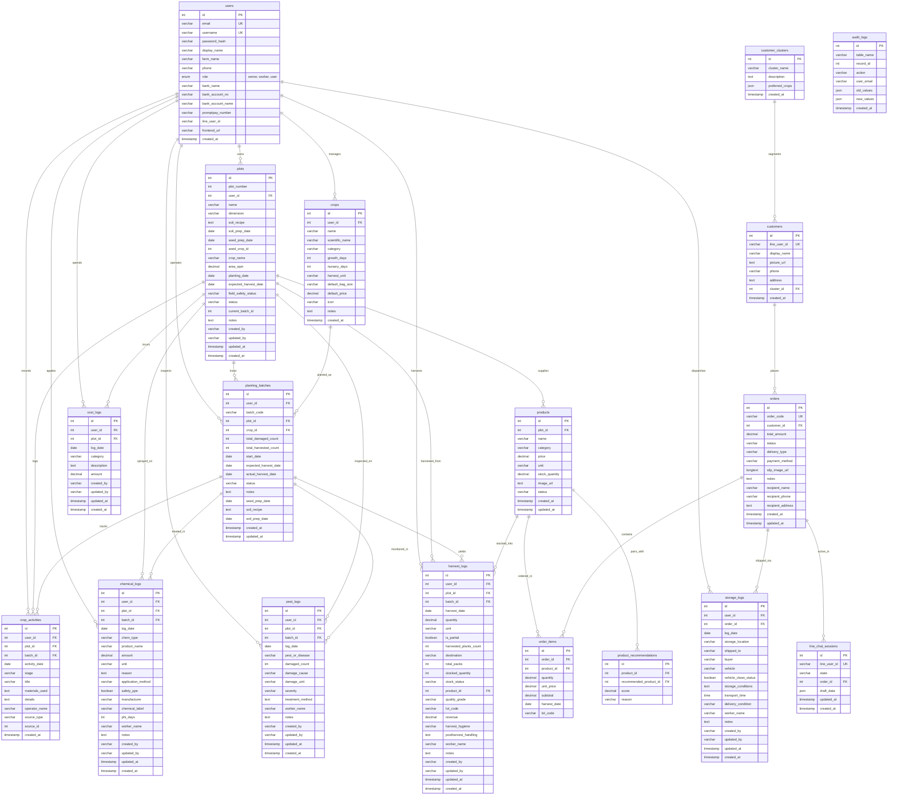

# แผนภาพแสดงความสัมพันธ์ข้อมูล (Entity Relationship Diagram: ERD)

เอกสารฉบับนี้แสดงรายละเอียดโครงสร้างฐานข้อมูลและแผนภาพความสัมพันธ์ของข้อมูล (ER Diagram) ของระบบ **FarmGAP** ฉบับสมบูรณ์ ซึ่งตรงกับฐานข้อมูล MySQL จริง (`farmgap`) และไฟล์ [`backend/db/schema.sql`](backend/db/schema.sql) ทุกประการ (จำนวน **18 ตาราง**)

---

## 1. สรุปการจัดกลุ่มตารางฐานข้อมูลทั้ง 18 ตาราง

ฐานข้อมูลของระบบ **FarmGAP** แบ่งออกเป็น 4 กลุ่มโดเมนหลักตามสถาปัตยกรรมของระบบ ได้แก่:

1. **กลุ่มจัดการฟาร์ม แปลงปลูก และรอบการปลูก (Core Farm & Crop Cycle — 5 ตาราง)**
   - `users`: ข้อมูลบัญชีผู้ใช้งาน เจ้าของฟาร์ม ตั้งค่าการรับชำระเงิน (ธนาคาร/PromptPay) และ LINE User ID สำหรับรับแจ้งเตือน
   - `crops`: คลังข้อมูลชนิดผัก อายุการเจริญเติบโต ระยะเวลาเพาะกล้า และขนาดบรรจุภัณฑ์มาตรฐาน
   - `plots`: ข้อมูลแปลงปลูก/แคร่ปลูก สูตรดิน สถานะแปลงปัจจุบัน (`empty`, `growing`, `harvest_ready`) และข้อมูลการเพาะกล้าเบื้องต้น
   - `planting_batches`: ข้อมูลรอบการปลูก (`BATCH-...`) ที่เชื่อมโยงแปลงปลูกและชนิดผัก พร้อมยอดต้นเสียหายและยอดเก็บเกี่ยวสะสม
   - `crop_activities`: ไทม์ไลน์บันทึกกิจกรรมประจำแปลงและรอบการปลูกตามเกณฑ์ GAP

2. **กลุ่มบันทึกมาตรฐาน GAP และการควบคุมคุณภาพ (GAP Compliance & Logs — 6 ตาราง)**
   - `chemical_logs`: บันทึกการใส่ปุ๋ย/ชีวภัณฑ์ การสวมใส่อุปกรณ์ป้องกัน (PPE) และระยะเวลาปลอดภัยก่อนเก็บเกี่ยว (PHI)
   - `pest_logs`: บันทึกการสำรวจโรคและแมลงศัตรูพืช จำนวนต้นที่เสียหาย และวิธีการจัดการ
   - `harvest_logs`: บันทึกการเก็บเกี่ยวผลผลิต รหัสล็อต (`lot_code`) การคัดเกรด และการนำเข้าสต็อกสินค้าพร้อมขาย
   - `storage_logs`: บันทึกการจัดเก็บและขนส่งผลผลิตตามมาตรฐาน GAP ข้อ 6 (เชื่อมโยงกับคำสั่งซื้อที่จัดส่ง)
   - `cost_logs`: บันทึกบัญชีต้นทุนและค่าใช้จ่ายในการผลิต
   - `audit_logs`: บันทึกประวัติการเพิ่ม แก้ไข และลบข้อมูลสำคัญในระบบ (Audit Trail)

3. **กลุ่มพาณิชย์อิเล็กทรอนิกส์และคำสั่งซื้อ (E-Commerce & Inventory — 4 ตาราง)**
   - `products`: รายการสินค้าผักสดพร้อมขาย ราคา และจำนวนสต็อกคงเหลือ
   - `orders`: ข้อมูลคำสั่งซื้อ สถานะการชำระเงิน รูปสลิปโอนเงิน และข้อมูลผู้รับปลายทาง
   - `order_items`: รายการสินค้าย่อยในแต่ละคำสั่งซื้อ พร้อมผูกวันที่เก็บเกี่ยวและรหัสล็อต (`lot_code`)
   - `product_recommendations`: ตารางความสัมพันธ์แนะนำสินค้าซื้อคู่กัน (Market Basket Analysis Co-occurrence)

4. **กลุ่มลูกค้า LINE OA และปัญญาประดิษฐ์ (LINE OA, Chatbot & AI Analytics — 3 ตาราง)**
   - `customer_clusters`: กลุ่มลูกค้าจากการวิเคราะห์ด้วยอัลกอริทึม K-Means Clustering ($K=3$)
   - `customers`: ข้อมูลสมาชิกและลูกค้าที่เชื่อมต่อผ่าน LINE Official Account
   - `line_chat_sessions`: ตารางจัดการสถานะการสนทนา (State Machine) และตะกร้าสินค้าชั่วคราวในแชทบอท LINE

---

## 2. แผนภาพ ER Diagram (Mermaid)

---

## 3. รายละเอียดโครงสร้างตารางฐานข้อมูลทั้ง 18 ตาราง (Schema Details)

### 1) `users` (ตารางผู้ใช้งานระบบและตั้งค่าฟาร์ม)
* `id`: `INT AUTO_INCREMENT` **[PK]** — รหัสผู้ใช้งาน
* `email`: `VARCHAR(255) UNIQUE NOT NULL` **[UK]** — อีเมลสำหรับเข้าสู่ระบบ
* `username`: `VARCHAR(100) UNIQUE NULL` **[UK]** — ชื่อผู้ใช้สำหรับเข้าสู่ระบบ
* `password_hash`: `VARCHAR(255) NOT NULL` — รหัสผ่านที่เข้ารหัสด้วย bcrypt
* `display_name`: `VARCHAR(255)` — ชื่อผู้ใช้งานที่แสดงในระบบ
* `farm_name`: `VARCHAR(255)` — ชื่อฟาร์ม
* `phone`: `VARCHAR(50)` — เบอร์โทรศัพท์ติดต่อฟาร์ม
* `role`: `ENUM('owner','worker','user')` — สิทธิ์การใช้งานระบบ
* `bank_name`: `VARCHAR(100)` — ชื่อธนาคารสำหรับรับโอนเงิน
* `bank_account_no`: `VARCHAR(50)` — เลขที่บัญชีธนาคาร
* `bank_account_name`: `VARCHAR(150)` — ชื่อบัญชีธนาคาร
* `promptpay_number`: `VARCHAR(50)` — หมายเลขพร้อมเพย์สำหรับสร้าง QR Code รับชำระเงินอัตโนมัติ
* `line_user_id`: `VARCHAR(255)` — LINE User ID ของเจ้าของฟาร์มสำหรับรับแจ้งเตือนออเดอร์/สลิปใหม่
* `frontend_url`: `VARCHAR(255)` — URL หน้าเว็บหลักของระบบ
* `created_at`: `TIMESTAMP` — วันเวลาที่สร้างบัญชี

### 2) `crops` (ตารางคลังข้อมูลชนิดผัก)
* `id`: `INT AUTO_INCREMENT` **[PK]** — รหัสชนิดผัก
* `user_id`: `INT NULL` **[FK -> users.id]** — ผู้สร้างข้อมูลชนิดผัก
* `name`: `VARCHAR(100) NOT NULL` — ชื่อชนิดผัก (เช่น ผักบุ้งจีน, กรีนโอ๊ค, เรดโอ๊ค)
* `scientific_name`: `VARCHAR(150)` — ชื่อวิทยาศาสตร์
* `category`: `VARCHAR(50)` — หมวดหมู่พืช (เช่น ผักสลัด, ผักกินใบ)
* `growth_days`: `INT DEFAULT 30` — อายุการปลูกจนถึงวันเก็บเกี่ยว (วัน)
* `nursery_days`: `INT DEFAULT 14` — ระยะเวลาเพาะกล้า (วัน)
* `harvest_unit`: `VARCHAR(50) DEFAULT 'กก.'` — หน่วยวัดผลผลิต
* `default_bag_size`: `VARCHAR(100)` — ขนาดถุงบรรจุมาตรฐาน
* `default_price`: `DECIMAL(10,2)` — ราคาขายมาตรฐานต่อถุง
* `icon`: `VARCHAR(50)` — ไอคอนแสดงผล
* `notes`: `TEXT` — หมายเหตุวิธีเพาะปลูก
* `created_at`: `TIMESTAMP` — วันเวลาที่สร้างรายการ

### 3) `plots` (ตารางแปลงปลูกและแคร่ปลูก)
* `id`: `INT AUTO_INCREMENT` **[PK]** — รหัสแปลงปลูก
* `plot_number`: `INT DEFAULT 1` — ลำดับที่ของแปลง/แคร่ปลูก
* `user_id`: `INT NOT NULL` **[FK -> users.id]** — เจ้าของแปลงปลูก
* `name`: `VARCHAR(255) NOT NULL` — ชื่อแปลง/แคร่ปลูก
* `dimension`: `VARCHAR(100)` — ขนาดแคร่ปลูก (เช่น แคร่ 2 x 6 เมตร)
* `soil_recipe`: `TEXT` — สูตรผสมดินประจำรอบปัจจุบัน
* `soil_prep_date`: `DATE NULL` — วันที่เตรียมดินของรอบปัจจุบัน
* `seed_prep_date`: `DATE NULL` — วันที่เริ่มเพาะกล้าของรอบปัจจุบัน
* `seed_crop_id`: `INT NULL` — รหัสชนิดผักที่กำลังเพาะกล้าในแปลงว่าง
* `crop_name`: `VARCHAR(255) NULL` — ชื่อผักที่กำลังปลูกอยู่ในแปลงขณะนั้น (รีเซ็ตเป็น `-` เมื่อแปลงว่าง)
* `area_sqm`: `DECIMAL(10,2)` — ขนาดพื้นที่แปลง (ตารางเมตร)
* `planting_date`: `DATE NULL` — วันที่ย้ายกล้าลงปลูกในรอบปัจจุบัน
* `expected_harvest_date`: `DATE NULL` — วันคาดการณ์เก็บเกี่ยวของรอบปัจจุบัน
* `field_safety_status`: `VARCHAR(50) DEFAULT 'ปลอดภัย'` — สถานะความปลอดภัยของแปลง
* `status`: `VARCHAR(50) DEFAULT 'empty'` — สถานะแปลง (`empty`, `growing`, `harvest_ready`)
* `current_batch_id`: `INT NULL` — รหัสรอบการปลูกปัจจุบันที่กำลังดำเนินการอยู่
* `notes`: `TEXT` — หมายเหตุประจำแปลง
* `created_by`, `updated_by`, `updated_at`, `created_at` — ข้อมูลผู้สร้างและเวลาแก้ไขล่าสุด

### 4) `planting_batches` (ตารางรอบการปลูกพืช)
* `id`: `INT AUTO_INCREMENT` **[PK]** — รหัสรอบการปลูก
* `user_id`: `INT NOT NULL` **[FK -> users.id]** — เจ้าของรอบการปลูก
* `batch_code`: `VARCHAR(50) NOT NULL` — รหัสอ้างอิงรอบการปลูก (เช่น `BATCH-261001-P3-882`)
* `plot_id`: `INT NOT NULL` **[FK -> plots.id]** — แปลงปลูกที่ใช้ในรอบนี้
* `crop_id`: `INT NOT NULL` **[FK -> crops.id]** — ชนิดผักที่ปลูกในรอบนี้
* `total_damaged_count`: `INT DEFAULT 0` — จำนวนต้นที่เสียหายสะสมในรอบนี้
* `total_harvested_count`: `INT DEFAULT 0` — จำนวนต้นที่เก็บเกี่ยวแล้วสะสมในรอบนี้
* `start_date`: `DATE NOT NULL` — วันที่เริ่มปลูกลงแปลง
* `expected_harvest_date`: `DATE NOT NULL` — วันที่คาดว่าจะเก็บเกี่ยว
* `actual_harvest_date`: `DATE NULL` — วันที่เก็บเกี่ยวจริง
* `status`: `VARCHAR(50) DEFAULT 'growing'` — สถานะรอบการปลูก (`growing`, `harvest_ready`, `harvested`)
* `notes`: `TEXT` — หมายเหตุรอบการปลูก
* `seed_prep_date`: `DATE NULL` — วันที่เพาะเมล็ดของรอบนี้
* `soil_recipe`: `TEXT NULL` — สูตรดินที่ใช้ในรอบนี้
* `soil_prep_date`: `DATE NULL` — วันที่เตรียมดินของรอบนี้
* `created_at`, `updated_at` — วันเวลาที่สร้างและอัปเดตข้อมูล

### 5) `crop_activities` (ตารางไทม์ไลน์กิจกรรมในแปลงปลูก)
* `id`: `INT AUTO_INCREMENT` **[PK]** — รหัสกิจกรรม
* `user_id`: `INT NOT NULL` **[FK -> users.id]** — ผู้บันทึกกิจกรรม
* `plot_id`: `INT NOT NULL` **[FK -> plots.id]** — แปลงปลูกที่ทำกิจกรรม
* `batch_id`: `INT NULL` **[FK -> planting_batches.id]** — รหัสรอบการปลูกของกิจกรรมนี้
* `activity_date`: `DATE NOT NULL` — วันที่ปฏิบัติงาน
* `stage`: `VARCHAR(50) NOT NULL` — ขั้นตอนการปลูก (`soil_prep`, `seeding`, `nursery`, `planting`, `growing`, `fertilizing`, `pest_control`, `harvest`)
* `title`: `VARCHAR(255) NOT NULL` — หัวข้อกิจกรรม
* `materials_used`: `TEXT NULL` — วัสดุ/ปัจจัยการผลิตที่ใช้
* `details`: `TEXT NULL` — รายละเอียดการปฏิบัติงาน
* `operator_name`: `VARCHAR(255)` — ชื่อผู้ปฏิบัติงาน
* `source_type`: `VARCHAR(32) NULL` — ประเภทตารางต้นทางที่ซิงค์ข้อมูลมา (`chemical`, `pest`)
* `source_id`: `INT NULL` — รหัสอ้างอิงจากตารางต้นทางที่ซิงค์มา
* `created_at`: `TIMESTAMP` — วันเวลาที่บันทึก

### 6) `chemical_logs` (ตารางบันทึกปุ๋ย สารชีวภัณฑ์ และการควบคุมระยะปลอดภัย PHI)
* `id`: `INT AUTO_INCREMENT` **[PK]** — รหัสบันทึก
* `user_id`: `INT NOT NULL` **[FK -> users.id]** — ผู้บันทึก
* `plot_id`: `INT NOT NULL` **[FK -> plots.id]** — แปลงที่ใช้ปุ๋ย/สารชีวภัณฑ์
* `batch_id`: `INT NULL` **[FK -> planting_batches.id]** — รอบการปลูกที่ใช้สาร
* `log_date`: `DATE NOT NULL` — วันที่ใส่ปุ๋ย/พ่นสาร
* `chem_type`: `VARCHAR(100) NOT NULL` — ประเภทสาร (ปุ๋ยอินทรีย์, น้ำหมักชีวภาพ, สารชีวภัณฑ์)
* `product_name`: `VARCHAR(255) NOT NULL` — ชื่อปุ๋ยหรือสารที่ใช้
* `amount`, `unit`: `DECIMAL(10,2)`, `VARCHAR(50)` — ปริมาณและหน่วยที่ใช้
* `reason`: `TEXT` — เหตุผลในการใช้
* `application_method`: `VARCHAR(100)` — วิธีการนำไปใช้
* `safety_ppe`: `BOOLEAN DEFAULT FALSE` — การสวมใส่อุปกรณ์ป้องกันความปลอดภัย (PPE)
* `manufacturer`, `chemical_label`: `VARCHAR(255)` — แหล่งผลิตและฉลากอ้างอิง
* `phi_days`: `INT DEFAULT 0` — จำนวนวันระยะปลอดภัยก่อนเก็บเกี่ยว (Pre-Harvest Interval)
* `worker_name`: `VARCHAR(255)` — ผู้ปฏิบัติงาน
* `notes`, `created_by`, `updated_by`, `updated_at`, `created_at`

### 7) `pest_logs` (ตารางบันทึกการสำรวจโรคและแมลงศัตรูพืช)
* `id`: `INT AUTO_INCREMENT` **[PK]** — รหัสบันทึก
* `user_id`: `INT NOT NULL` **[FK -> users.id]** — ผู้บันทึก
* `plot_id`: `INT NOT NULL` **[FK -> plots.id]** — แปลงที่สำรวจพบ
* `batch_id`: `INT NULL` **[FK -> planting_batches.id]** — รอบการปลูกที่สำรวจพบ
* `log_date`: `DATE NOT NULL` — วันที่สำรวจ
* `pest_or_disease`: `VARCHAR(255) NOT NULL` — ชนิดโรคหรือแมลงศัตรูพืชที่พบ
* `damaged_count`: `INT DEFAULT 0` — จำนวนต้นที่เสียหายและตัดจำหน่ายออก
* `damage_cause`: `VARCHAR(100) NULL` — สาเหตุความเสียหาย
* `damage_unit`: `VARCHAR(50) DEFAULT 'ต้น'` — หน่วยความเสียหาย
* `severity`: `VARCHAR(50)` — ระดับความรุนแรง
* `treatment_method`: `TEXT` — วิธีการป้องกันและกำจัด
* `worker_name`, `notes`, `created_by`, `updated_by`, `updated_at`, `created_at`

### 8) `harvest_logs` (ตารางบันทึกการเก็บเกี่ยวและรหัสล็อต Traceability)
* `id`: `INT AUTO_INCREMENT` **[PK]** — รหัสการเก็บเกี่ยว
* `user_id`: `INT NOT NULL` **[FK -> users.id]** — ผู้บันทึก
* `plot_id`: `INT NOT NULL` **[FK -> plots.id]** — แปลงที่เก็บเกี่ยว
* `batch_id`: `INT NULL` **[FK -> planting_batches.id]** — รอบการปลูกที่เก็บเกี่ยว
* `harvest_date`: `DATE NOT NULL` — วันที่เก็บเกี่ยวผลผลิต
* `quantity`, `unit`: `DECIMAL(10,2)`, `VARCHAR(50)` — น้ำหนักผลผลิตรวม (กก.)
* `is_partial`: `BOOLEAN DEFAULT FALSE` — สถานะการทยอยเก็บเกี่ยวบางส่วน (`true`) หรือเก็บเกี่ยวปิดรอบแปลง (`false`)
* `harvested_plants_count`: `INT DEFAULT 0` — จำนวนต้นที่ตัดเก็บเกี่ยวในครั้งนี้
* `destination`: `VARCHAR(50)` — ปลายทางผลผลิต (`cold_storage` หรือ `line_store`)
* `total_packs`: `INT DEFAULT 0` — จำนวนถุงที่บรรจุได้ทั้งหมด
* `stocked_quantity`: `INT DEFAULT 0` — จำนวนถุงที่นำเข้าสต็อกหน้าร้านแล้ว
* `stock_status`: `VARCHAR(50)` — สถานะการนำเข้าสต็อก (`unstocked`, `partial`, `fully_stocked`)
* `product_id`: `INT NULL` **[FK -> products.id]** — รหัสสินค้าหน้าร้านที่รับสต็อกจากล็อตนี้
* `quality_grade`: `VARCHAR(50)` — เกรดคุณภาพผลผลิต
* `lot_code`: `VARCHAR(100)` — รหัสล็อตผลผลิตสำหรับสร้าง QR Code สืบย้อนกลับ
* `revenue`: `DECIMAL(12,2)` — มูลค่าผลผลิตตามราคาประเมิน
* `harvest_hygiene`, `postharvest_handling`, `worker_name`, `notes`, `created_by`, `updated_by`, `updated_at`, `created_at`

### 9) `products` (ตารางสินค้าและสต็อกพร้อมขายหน้าร้าน LINE)
* `id`: `INT AUTO_INCREMENT` **[PK]** — รหัสสินค้า
* `plot_id`: `INT NULL` **[FK -> plots.id]** — แปลงปลูกต้นทางล่าสุดของสินค้า
* `name`: `VARCHAR(255) NOT NULL` — ชื่อสินค้า
* `category`: `VARCHAR(100)` — หมวดหมู่สินค้า
* `price`: `DECIMAL(10,2) NOT NULL` — ราคาขายต่อหน่วย (บาท)
* `unit`: `VARCHAR(50)` — หน่วยขาย (เช่น ถุง, กก.)
* `stock_quantity`: `DECIMAL(10,2) DEFAULT 0` — จำนวนสินค้าคงเหลือพร้อมขาย
* `image_url`: `TEXT` — ลิงก์รูปภาพสินค้า
* `status`: `VARCHAR(50) DEFAULT 'available'` — สถานะการวางจำหน่าย (`available`, `out_of_stock`)
* `created_at`, `updated_at`

### 10) `customers` (ตารางข้อมูลลูกค้าสมาชิก LINE OA)
* `id`: `INT AUTO_INCREMENT` **[PK]** — รหัสลูกค้า
* `line_user_id`: `VARCHAR(255) UNIQUE NOT NULL` **[UK]** — LINE User ID ของลูกค้า
* `display_name`: `VARCHAR(255)` — ชื่อโปรไฟล์ LINE หรือชื่อผู้รับ
* `picture_url`: `TEXT` — ลิงก์รูปโปรไฟล์ LINE
* `phone`: `VARCHAR(50)` — เบอร์โทรศัพท์ลูกค้า
* `address`: `TEXT` — ที่อยู่สำหรับจัดส่งสินค้า
* `cluster_id`: `INT NULL` **[FK -> customer_clusters.id]** — กลุ่มลูกค้าจากการจัดกลุ่มด้วย K-Means
* `created_at`: `TIMESTAMP`

### 11) `customer_clusters` (ตารางกลุ่มลูกค้าจากอัลกอริทึม K-Means Clustering)
* `id`: `INT AUTO_INCREMENT` **[PK]** — รหัสกลุ่มลูกค้า
* `cluster_name`: `VARCHAR(100) NOT NULL` — ชื่อกลุ่มลูกค้า
* `description`: `TEXT` — คำอธิบายพฤติกรรมการสั่งซื้อของกลุ่ม
* `preferred_crops`: `JSON` — รายการสินค้าที่กลุ่มนี้นิยมซื้อสูงสุด
* `created_at`: `TIMESTAMP`

### 12) `orders` (ตารางคำสั่งซื้อสินค้า)
* `id`: `INT AUTO_INCREMENT` **[PK]** — รหัสคำสั่งซื้อ
* `order_code`: `VARCHAR(50) UNIQUE NOT NULL` **[UK]** — เลขที่ใบสั่งซื้อ (เช่น `ORD-20261020-1234`)
* `customer_id`: `INT NOT NULL` **[FK -> customers.id]** — รหัสลูกค้าที่สั่งซื้อ
* `total_amount`: `DECIMAL(12,2) NOT NULL` — ยอดเงินรวมสุทธิ (บาท)
* `status`: `VARCHAR(50) DEFAULT 'pending'` — สถานะคำสั่งซื้อ (`pending`, `paid`, `shipping`, `completed`, `cancelled`)
* `delivery_type`: `VARCHAR(50) DEFAULT 'delivery'` — รูปแบบการรับสินค้า (`delivery`, `pickup`)
* `payment_method`: `VARCHAR(50) DEFAULT 'transfer'` — ช่องทางชำระเงิน (`transfer`, `cod`)
* `slip_image_url`: `LONGTEXT` — ลิงก์ภาพหลักฐานการโอนเงิน (สลิป)
* `notes`: `TEXT` — หมายเหตุคำสั่งซื้อ
* `recipient_name`: `VARCHAR(255) NULL` — ชื่อผู้รับสินค้าของออเดอร์นี้ (Snapshot)
* `recipient_phone`: `VARCHAR(50) NULL` — เบอร์โทรศัพท์ผู้รับสินค้าของออเดอร์นี้
* `recipient_address`: `TEXT NULL` — ที่อยู่จัดส่งผู้รับสินค้าของออเดอร์นี้
* `created_at`, `updated_at`

### 13) `order_items` (ตารางรายการสินค้าย่อยในแต่ละคำสั่งซื้อ)
* `id`: `INT AUTO_INCREMENT` **[PK]** — รหัสรายการสินค้าย่อย
* `order_id`: `INT NOT NULL` **[FK -> orders.id]** — รหัสคำสั่งซื้อหลัก
* `product_id`: `INT NOT NULL` **[FK -> products.id]** — รหัสสินค้าที่สั่งซื้อ
* `quantity`: `DECIMAL(10,2) NOT NULL` — จำนวนที่สั่งซื้อ
* `unit_price`: `DECIMAL(10,2) NOT NULL` — ราคาขายต่อหน่วย ณ เวลาที่สั่งซื้อ
* `subtotal`: `DECIMAL(10,2) NOT NULL` — ราคารวมย่อยของรายการนี้
* `harvest_date`: `DATE NULL` — วันที่เก็บเกี่ยวของล็อตสินค้าที่จัดส่งในรายการนี้
* `lot_code`: `VARCHAR(100) NULL` — รหัสล็อต (`lot_code`) สำหรับตรวจสอบย้อนกลับจากใบสั่งซื้อ

### 14) `product_recommendations` (ตารางจับคู่สินค้าแนะนำซื้อคู่กัน)
* `id`: `INT AUTO_INCREMENT` **[PK]** — รหัสรายการแนะนำ
* `product_id`: `INT NOT NULL` **[FK -> products.id]** — รหัสสินค้าหลัก
* `recommended_product_id`: `INT NOT NULL` **[FK -> products.id]** — รหัสสินค้าที่แนะนำให้ซื้อคู่กัน
* `score`: `DECIMAL(5,4)` — ค่าคะแนนความสัมพันธ์จากการซื้อร่วมกัน (Co-occurrence Score)
* `reason`: `VARCHAR(255)` — คำอธิบายเหตุผลการแนะนำ

### 15) `line_chat_sessions` (ตารางจัดการสถานะการสนทนาสั่งซื้อผ่าน LINE Chatbot)
* `id`: `INT AUTO_INCREMENT` **[PK]** — รหัสเซสชัน
* `line_user_id`: `VARCHAR(255) UNIQUE NOT NULL` **[UK]** — LINE User ID ของผู้สนทนา
* `state`: `VARCHAR(50) NOT NULL DEFAULT 'IDLE'` — สถานะปัจจุบันของบทสนทนา (`IDLE`, `SELECTING_QTY`, `AWAITING_CONTACT`, `CONFIRMING_ORDER`, `AWAITING_PAYMENT`)
* `order_id`: `INT NULL` **[FK -> orders.id]** — รหัสคำสั่งซื้อที่กำลังรอชำระเงินในแชท
* `draft_data`: `JSON NULL` — ข้อมูลตะกร้าสินค้าและที่อยู่ชั่วคราวระหว่างการสนทนา
* `updated_at`, `created_at`

### 16) `storage_logs` (ตารางบันทึกการเก็บรักษาและการขนส่งตามมาตรฐาน GAP ข้อ 6)
* `id`: `INT AUTO_INCREMENT` **[PK]** — รหัสบันทึกการจัดเก็บ/ขนส่ง
* `user_id`: `INT NOT NULL` **[FK -> users.id]** — ผู้บันทึก
* `order_id`: `INT NULL` **[FK -> orders.id]** — รหัสคำสั่งซื้อที่ซิงค์ข้อมูลการจัดส่งมาโดยอัตโนมัติ
* `log_date`: `DATE NOT NULL` — วันที่จัดส่ง/เก็บรักษา
* `storage_location`: `VARCHAR(255)` — สถานที่เก็บรักษา/คลังกระจายสินค้า
* `shipped_to`: `VARCHAR(255)` — สถานที่จัดส่งปลายทาง
* `buyer`: `VARCHAR(255)` — ชื่อผู้ซื้อ/ผู้รับปลายทาง
* `vehicle`: `VARCHAR(255)` — ยานพาหนะที่ใช้ขนส่ง
* `vehicle_clean_status`: `BOOLEAN DEFAULT FALSE` — สถานะความสะอาดของยานพาหนะขนส่ง
* `storage_conditions`: `TEXT` — สภาพการเก็บรักษาและควบคุมอุณหภูมิระหว่างขนส่ง
* `transport_time`: `TIME` — เวลาที่ทำการขนส่ง
* `delivery_condition`: `VARCHAR(50)` — สภาพผลผลิตเมื่อถึงมือผู้รับ
* `worker_name`, `notes`, `created_by`, `updated_by`, `updated_at`, `created_at`

### 17) `cost_logs` (ตารางบันทึกต้นทุนและค่าใช้จ่ายการผลิต)
* `id`: `INT AUTO_INCREMENT` **[PK]** — รหัสรายการต้นทุน
* `user_id`: `INT NOT NULL` **[FK -> users.id]** — ผู้บันทึก
* `plot_id`: `INT NULL` **[FK -> plots.id]** — แปลงปลูกที่เกิดค่าใช้จ่าย (หรือ `NULL` สำหรับค่าใช้จ่ายส่วนกลางของฟาร์ม)
* `log_date`: `DATE NOT NULL` — วันที่เกิดรายการค่าใช้จ่าย
* `category`: `VARCHAR(100) NOT NULL` — หมวดหมู่ต้นทุน (เมล็ดพันธุ์, ปุ๋ย/วัสดุปลูก, แรงงาน, ค่าตรวจวิเคราะห์ ฯลฯ)
* `description`: `TEXT` — รายละเอียดรายการค่าใช้จ่าย
* `amount`: `DECIMAL(12,2) NOT NULL` — จำนวนเงิน (บาท)
* `created_by`, `updated_by`, `updated_at`, `created_at`

### 18) `audit_logs` (ตารางบันทึกประวัติการเปลี่ยนแปลงข้อมูลในระบบ)
* `id`: `INT AUTO_INCREMENT` **[PK]** — รหัสประวัติการแก้ไข
* `table_name`: `VARCHAR(255) NOT NULL` — ชื่อตารางที่มีการเปลี่ยนแปลงข้อมูล
* `record_id`: `INT` — รหัสแถวข้อมูลที่ถูกดำเนินการ
* `action`: `VARCHAR(50) NOT NULL` — ประเภทการกระทำ (`CREATE`, `UPDATE`, `DELETE`)
* `user_email`: `VARCHAR(255)` — อีเมลของผู้ใช้งานที่ดำเนินการ
* `old_values`: `JSON` — ข้อมูลเดิมก่อนการแก้ไข/ลบ
* `new_values`: `JSON` — ข้อมูลใหม่หลังการเพิ่ม/แก้ไข
* `created_at`: `TIMESTAMP` — วันเวลาที่เกิดรายการ
